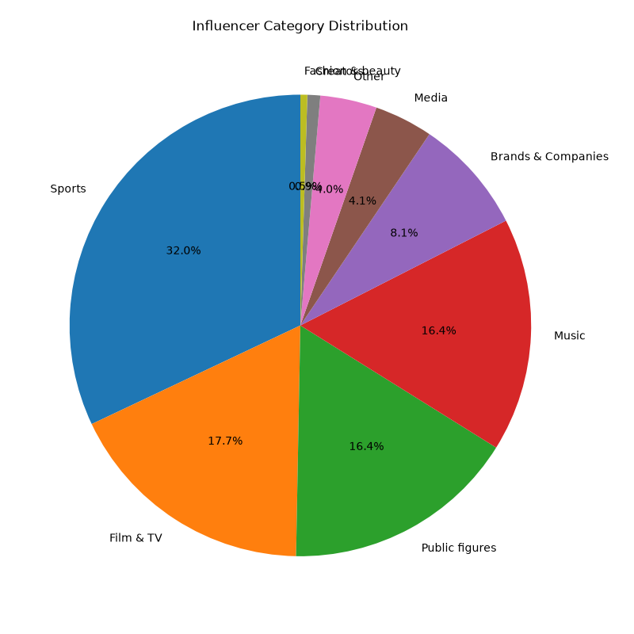
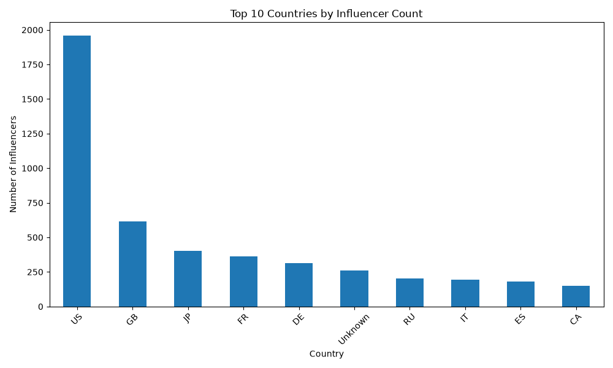

# 📊 Instagram Influencer Analytics

**SR NEXT – Data Analytics Project**

An end-to-end Python data analytics project that explores Instagram influencer account data, performs data cleaning, creates useful features, and visualizes influencer distribution across countries and categories.

## 🎯 Project Overview

The project analyzes Instagram account-level data to understand how influencers are distributed across different follower ranges, countries, and content categories.

The goal is to transform raw data into structured datasets and visual insights that can support influencer research and discovery.

## 🛠️ Technologies Used

- Python
- Pandas
- Matplotlib
- CSV Data Processing
- Git & GitHub
- Visual Studio Code

## 📁 Project Structure

```text
instagram-influencer-analytics/
│
├── data/
│   ├── raw/
│   │   ├── instagram_latest.csv
│   │   └── influencers.csv
│   │
│   └── processed/
│       ├── category_distribution.png
│       ├── top_countries.png
│       ├── country_category_analysis.csv
│       ├── influencer_analysis.csv
│       ├── influencers_cleaned.csv
│       ├── influencers_features.csv
│       └── influencers_under_1m.csv
│
├── src/
│   ├── analyze_data.py
│   ├── category_visualization.py
│   ├── country_category_analysis.py
│   ├── create_sample_data.py
│   ├── data_quality_check.py
│   ├── feature_engineering.py
│   ├── filter_influencers.py
│   └── influencer_visualization.py
│
├── .gitignore
└── README.md
```

## ⚙️ Project Workflow

1. Load raw Instagram influencer account data.
2. Clean and filter records.
3. Remove duplicate usernames.
4. Filter accounts with fewer than 1 million followers.
5. Create follower-based influencer segments.
6. Analyze country and category distributions.
7. Generate charts and processed CSV datasets.
8. Perform data quality checks.

## 📈 Key Analysis Results

The analysis produced **7,241 influencer records** after filtering and cleaning.

### Influencer Segmentation

| Influencer Segment | Follower Range |
|---|---:|
| Nano | Below 10K |
| Micro | 10K–49,999 |
| Mid-tier | 50K–499,999 |
| Macro | 500K–999,999 |

### Top Countries by Influencer Count

| Country | Influencer Count |
|---|---:|
| United States | 1,957 |
| United Kingdom | 615 |
| Japan | 402 |
| France | 361 |
| Germany | 313 |

### Data Quality

- Total records analyzed: 7,241
- Duplicate usernames after cleaning: 0
- Duplicate rows: 0
- Invalid follower records: 0
- Missing country values: 262

## 📊 Visualizations

### Influencer Distribution by Category



### Top Countries by Influencer Count



## 📂 Processed Datasets

- `influencers_under_1m.csv` – filtered influencer accounts.
- `influencers_features.csv` – dataset containing engineered follower-based features and segments.
- `country_category_analysis.csv` – country and category analysis.
- `influencers_cleaned.csv` – small sample dataset.
- `influencer_analysis.csv` – small sample analysis dataset.

**Note:** The last two files are sample/demo outputs, not the full real-world dataset analysis.

## ▶️ How to Run the Project

Clone the repository:

```bash
git clone https://github.com/kashish172004/instagram-influencer-analytics.git
cd instagram-influencer-analytics
```

Install dependencies:

```bash
pip install pandas matplotlib
```

Run the analysis scripts in this order:

```bash
python src/filter_influencers.py
python src/feature_engineering.py
python src/influencer_visualization.py
python src/category_visualization.py
python src/country_category_analysis.py
python src/data_quality_check.py
```

## ⚠️ Project Limitations

- The dataset contains account-level information, not individual post-level likes and comments.
- Actual engagement rates cannot be calculated from the available fields.
- The project currently focuses on data cleaning, feature engineering, descriptive analysis, and visualization.
- It does not yet implement machine learning predictions or automated influencer recommendations.

## 🚀 Future Improvements

- Build an interactive analytics dashboard.
- Add machine learning-based influencer classification.
- Explore engagement analysis when post-level data becomes available.
- Develop an influencer discovery and recommendation system.
- Explore AI-powered insights and automation features.

## 👩‍💻 Author

**Kashish Walecha**

B.Tech – Mechatronics Engineering  
Delhi Skill and Entrepreneurship University

[GitHub Profile](https://github.com/kashish172004)

---

*Developed as part of the SR NEXT Data Analytics Project.*


